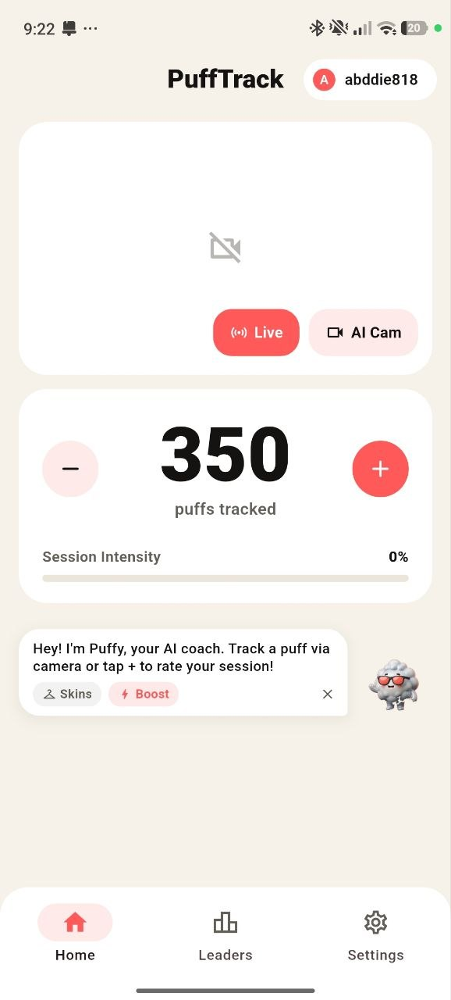
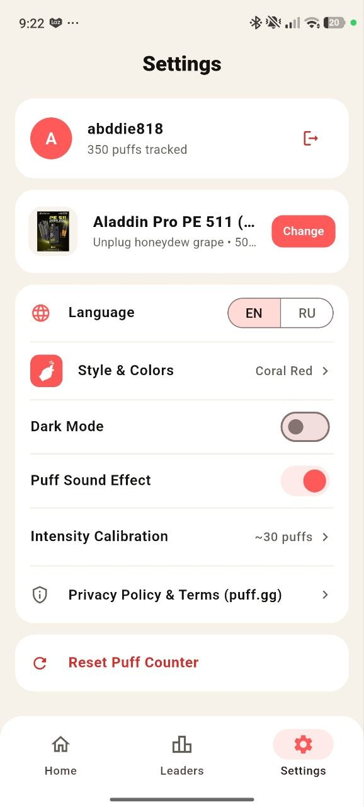
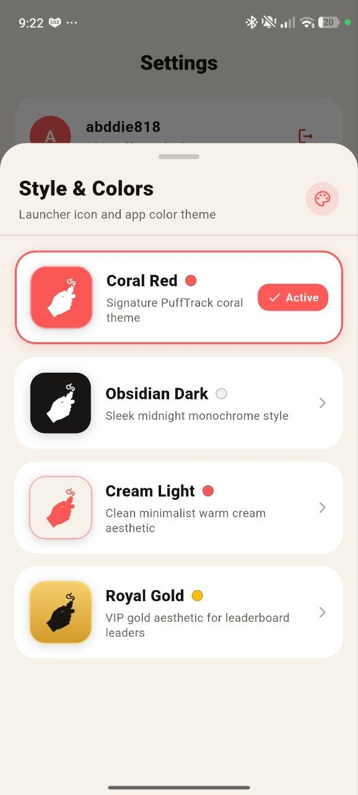
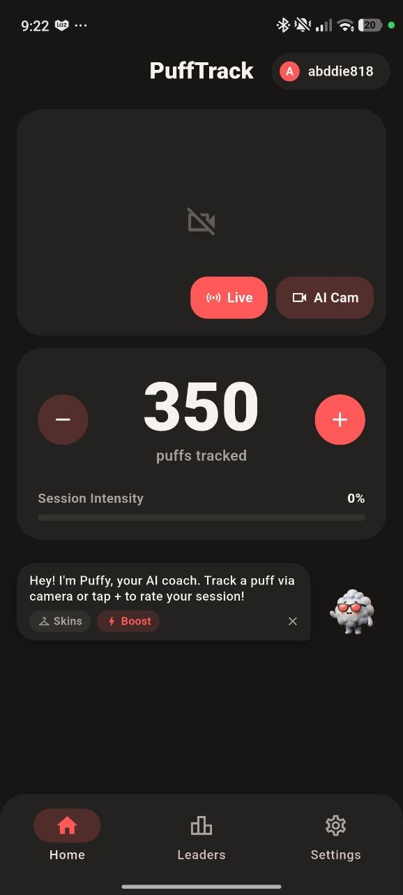

# PuffTrack — AI Puff Counter & Session Tracker

  <strong>Hands-free puff tracking powered by on-device computer vision, an interactive AI coach, and real-time 1v1 live sessions.</strong>

  
  
  
  
  

---

## Overview

**PuffTrack** eliminates manual `+1` button tapping by using **100% local, on-device computer vision** to detect and count puffs automatically via the front camera. All camera frames are processed strictly in device memory—zero video is recorded, stored, or uploaded to the cloud.

### Key Features

- **Hands-Free AI Camera Detection:** Real-time on-device CV inference tracks sessions automatically with zero server latency.
- **100% Privacy-First Architecture:** Video streams never leave the user's device.
- **Puffy AI Coach:** Interactive mascot with reactive commentary, custom skins, and session intensity tracking.
- **Live Roulette & 1v1 Battles:** Real-time peer-to-peer video rooms (`0 vs 0`) with instant invite deep links (`puff://room/...`), clipboard auto-detection, and built-in `Report / Block` moderation.
- **Global Leaderboard & Achievements:** Compete with friends and unlock milestones.
- **Custom Device Profiles & Themes:** Supports user-defined setups, dynamic color themes (*Coral Red*, *Obsidian Dark*, *Cream Light*, *Royal Gold*), and instant `EN / RU` localization.

---

## Screenshots

| Home (Light) | Leaderboard | Settings | Themes & Icons | Home (Dark) |
| :---: | :---: | :---: | :---: | :---: |
|  |  |  |  |  |

---

## Tech Stack

- **Framework:** Flutter & Dart
- **Computer Vision:** Local on-device ML / CV inference pipeline
- **Backend & Realtime:** Supabase (Auth, PostgreSQL Leaderboards, Realtime signaling)
- **Media & P2P:** WebRTC (`Live` video rooms)
- **Navigation & Deep Links:** Native Android `Intent` / App Links & clipboard invite detection

---

## Privacy & Compliance

<b>Age Restriction:</b> Intended strictly for adults (18+) with an upfront age-gate confirmation.

<b>Local Camera Processing:</b> Camera frames are analyzed transiently in RAM for puff detection and are immediately discarded.

<b>Community Safety:</b> Live rooms require explicit community guidelines acceptance and include instant one-tap user reporting and blocking.

# ! PuffTrack is a personal habit and session tracking utility built for informational and entertainment purposes. It does not promote or encourage smoking or vaping !
